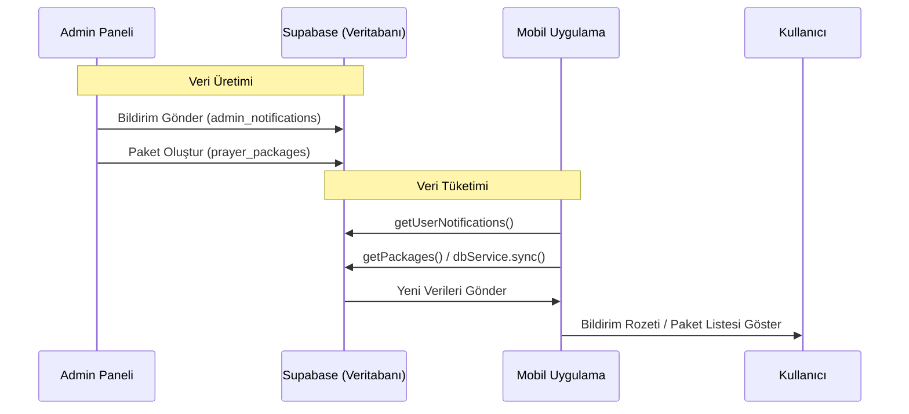

# Admin-Mobil Veri Akış Mimarisi

## Genel Bakış
Uygulama, Admin Paneli ve Mobil Uygulama arasında veri senkronizasyonu için **Supabase** veritabanını köprü olarak kullanır. Admin paneli veriyi yazar, mobil uygulama ise bu veriyi okur.

## 1. Bildirim Sistemi
*   **Yazma (Admin):** `AdminDashboard.tsx`, `sendGlobalNotification` fonksiyonunu kullanarak `admin_notifications` tablosuna kayıt atar.
*   **Okuma (Mobil):** `NotificationCenter.tsx` bileşeni, `getUserNotifications` servisini kullanarak bu tabloyu okur.
*   **Görüntüleme:** Kullanıcı "Zil" ikonuna tıkladığında bildirimler listelenir.

## 2. Dua Paketleri
*   **Yazma (Admin):** Admin panelinden oluşturulan paketler `prayer_packages` ve `package_items` tablolarına yazılır.
*   **Okuma (Mobil):** Uygulama açılışında `dbService` veya ilgili servisler aracılığıyla bu paketler senkronize edilir ve kullanıcının kütüphanesine veya paket listesine eklenir.

## 3. Günün Sözü
*   **Yazma (Admin):** Admin panelinden eklenen sözler `daily_quotes` tablosuna kaydedilir.
*   **Okuma (Mobil):** `App.tsx` açılışta `loadDailyQuote` fonksiyonu ile veritabanından rastgele bir söz çeker ve ana ekranda gösterir.

## Özet
Sistem "Yaz-Unut" prensibiyle çalışmaz; veritabanı tabanlı bir durum yönetimi vardır. Admin paneli bir "CMS" (İçerik Yönetim Sistemi) gibi davranır, Mobil uygulama ise bu içeriğin "Görüntüleyicisi"dir.
